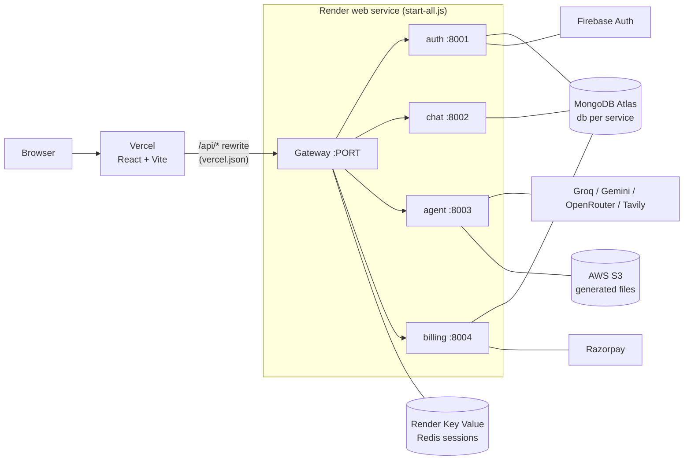
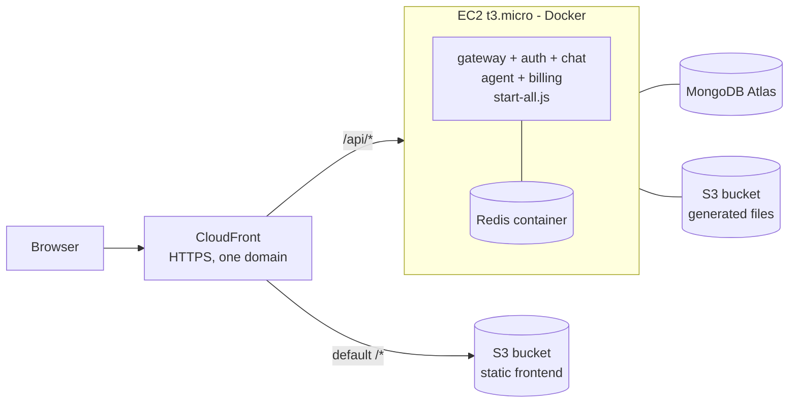

# CortexAI on AWS (Free Tier)

How CortexAI is deployed today, and the plan for running it on AWS inside the
Free Tier. The AWS section is a deployment **guide**, not a record of a running
deployment: nothing here has been created in an AWS account yet.

## 1. Current production (live)

Key design points (all already in the repo):

- **API gateway pattern.** Only the gateway is public. It validates the session
  cookie against Redis (`gateway/middleware/auth.middleware.js`), then proxies to
  the internal services with identity headers it sets itself.
- **Server-side sessions.** Firebase verifies the Google sign-in; the auth
  service issues an opaque `session` cookie (HttpOnly, 7 days) backed by Redis.
- **First-party cookie.** The frontend proxies `/api` through its own domain, so
  the cookie works in Safari/Firefox and `SameSite=Lax` blocks CSRF.
- **Database per service** on one Atlas cluster (auth, chat, billing).
- **Atomic credit accounting.** `deductCredits` uses a `$gte` guarded
  `findOneAndUpdate`, so parallel requests cannot overdraw credits.

## 2. Target on AWS (Free Tier)

| Piece | AWS service | Free Tier |
|---|---|---|
| Frontend | S3 (static files) + CloudFront | CloudFront 1 TB/month out, always free |
| API | One EC2 `t3.micro` running the backend image | 750 h/month for 12 months (account-age dependent) |
| Sessions | Redis container on the same instance | Included |
| Generated files | Existing S3 bucket | 5 GB for 12 months |
| Database | MongoDB Atlas M0 (unchanged) | Free |
| Auth | Firebase (unchanged) | Free |

Why one CloudFront in front of both: the browser keeps calling `/api/*` on the
same domain, exactly like the Vercel rewrite today, so the session cookie stays
first-party and no CORS or `SameSite=None` changes are needed.

### Things deliberately avoided (they cost money immediately)

NAT Gateway, Application/Network Load Balancer, ElastiCache, ECS Fargate,
Elastic IP left unattached, RDS/DocumentDB. This is why the design uses a
single instance with Redis in a container instead of the "textbook" managed
version.

## 3. Deployment steps

Prerequisites: an AWS account in good standing, AWS CLI configured
(`aws configure`, region `eu-north-1`), Docker.

1. **Budget guard first.** Billing -> Budgets -> create a `$1` monthly cost
   budget with email alerts.
2. **Image.** Build one backend image that runs `node start-all.js` (the same
   entrypoint Render uses) and push it to a registry (Docker Hub or ECR; ECR
   gives 500 MB private storage free for 12 months).
3. **EC2.** Launch a `t3.micro` (Amazon Linux 2023, 30 GB gp3 max). Security
   group: inbound 80 from CloudFront only, 22 from your IP only. Add 1-2 GB
   swap: six Node processes in 1 GB RAM is tight (`start-all.js` already caps
   each V8 heap).
4. **Run.** `docker compose up -d` with the backend container and
   `redis:7-alpine` (set `REDIS_URL=redis://redis:6379`). Put the variables from
   `backend/.env.example` in an env file on the instance (never in git).
5. **Frontend.** `npm run build` in `frontend/`, upload `dist/` to a private S3
   bucket, serve it through CloudFront using Origin Access Control.
6. **CloudFront.** Two origins: the S3 bucket (default behaviour) and the EC2
   public DNS (behaviour `/api/*`, caching disabled, forward cookies and
   headers). Set a custom error response `403/404 -> /index.html` for the SPA.
7. **Firebase.** Add the CloudFront domain to Authentication -> Settings ->
   Authorized domains, otherwise Google sign-in fails with
   `auth/unauthorized-domain`.
8. **Razorpay.** Point the webhook at `https://<cloudfront-domain>/api/billing/webhook`.
9. **Verify.** `curl -i https://<domain>/api/me` returns `401` without a cookie;
   sign in with Google, then reload and confirm you stay signed in.

### Teardown (so nothing is ever billed)

Delete in this order: CloudFront distribution (disable, wait, delete), S3
buckets (empty first), EC2 instance, its EBS volume and security group, any
unattached Elastic IP. Do this before the 12-month Free Tier window ends.

## 4. Known limits

- 1 GB RAM and a single instance: no high availability, slow cold paths.
- Free Tier terms depend on account age; check Billing -> Free Tier first.
- Redis in a container loses sessions if the volume is lost. Mount a volume
  and enable `appendonly yes` to survive restarts.

## 5. Talking points

- Why a gateway + per-service databases, and what you traded away by running
  the services in one container for cost.
- Why server-side sessions in Redis instead of JWTs (instant revocation, one
  active session per user).
- Why CloudFront fronts both the SPA and the API (first-party cookie, no CORS).
- The cost trade-offs above: what you would swap in for production (ALB +
  ECS/Fargate, ElastiCache, multi-AZ) and why you did not on a free budget.
